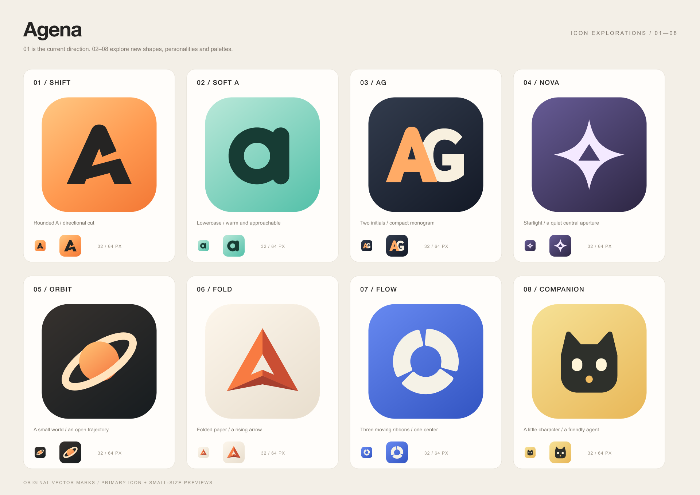

# Agena 图标候选

正式采用 **01：切口 A / Shift**。02–08 保留为设计探索稿。

| 编号 | 方向 | 视觉特点 | 高清 PNG | SVG 源文件 |
| --- | --- | --- | --- | --- |
| 01 | 切口 A / Shift | 暖橙色，圆顶字形，斜向开口 | [1024 px](01-shift-1024.png) | [SVG](01-shift.svg) |
| 02 | 小写 a / Soft A | 薄荷绿，圆润，亲和 | [1024 px](02-soft-a-1024.png) | [SVG](02-soft-a.svg) |
| 03 | AG 组合 / AG | 深色底，橙色 A 与米白色 G 交叠 | [1024 px](03-ag-monogram-1024.png) | [SVG](03-ag-monogram.svg) |
| 04 | 星核 / Nova | 紫色底，四角星，中间藏有三角形负空间 | [1024 px](04-nova-1024.png) | [SVG](04-nova.svg) |
| 05 | 轨道 / Orbit | 深色底，橙色星球，倾斜的米白色轨道 | [1024 px](05-orbit-1024.png) | [SVG](05-orbit.svg) |
| 06 | 折纸 / Fold | 米白底，橘红色折面，向上的 A 形箭头 | [1024 px](06-fold-1024.png) | [SVG](06-fold.svg) |
| 07 | 回旋 / Flow | 蓝色底，三段旋转的弧形，抽象符号 | [1024 px](07-flow-1024.png) | [SVG](07-flow.svg) |
| 08 | 小伙伴 / Companion | 暖黄色底，猫形小角色，轻松友好 | [1024 px](08-companion-1024.png) | [SVG](08-companion.svg) |

每款均包含 SVG、1024 px PNG，以及 32 / 64 px PNG 小尺寸预览。
所有图标由矢量路径绘制，图标本身不依赖字体或外部图片。
PNG 使用 `@resvg/resvg-js` 2.6.2 从各款 SVG 直接渲染。

本目录为设计探索归档。Shift 的正式源文件为
`packages/agena-web/src/assets/agena.svg`，各平台导出资源位于
`packages/agena-web/public/`。更新方式见 [Shift 图标说明](../agena-icon.md)。
