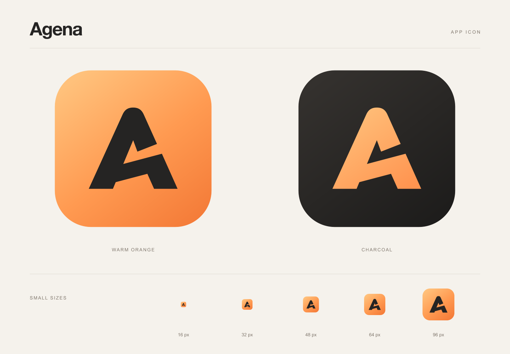

# Agena Shift app icon

**Shift (01) is the selected Agena app icon.** It is a custom uppercase **A**
with a rounded apex and a rising crossbar.
A diagonal opening on the right gives the letter a forward direction while
keeping its silhouette simple at favicon sizes. The warm orange palette matches
the application's existing accent colors.



## Source assets

The editable source is `packages/agena-web/src/assets/agena.svg`.
`AgenaLogo.vue` imports this source for the login page and the desktop/mobile
workspace and conversation empty states. Vite bundles the imported image with
the application so each new build carries the current branding.

The assets below are generated into `packages/agena-web/public/`.

| Asset | Purpose |
| --- | --- |
| `favicon.svg` | Primary SVG favicon, generated from the source |
| `logo-dark.svg` | Orange mark on a charcoal tile |
| `safari-pinned-tab.svg` | Solid monochrome mark for Safari's pinned-tab mask |
| `agena-icon-1024.png` | Primary icon at 1024 × 1024 |
| `agena-icon-dark-1024.png` | Dark icon at 1024 × 1024 |
| `favicon-{16,32,48}.png` | Browser PNG fallbacks |
| `favicon.ico` | ICO containing 16, 32, 48, 64, 128, and 256 px images |
| `apple-touch-icon-*.png` | Apple touch icons at 152 × 152, 167 × 167, and 180 × 180 |
| `apple-touch-icon.png` | Default Apple touch icon at 180 × 180 |
| `android-chrome-192x192.png`, `android-chrome-512x512.png` | Standard Android and desktop installation icons |
| `android-chrome-maskable-512x512.png` | Full-bleed icon for platform-specific corner masks |
| `site.webmanifest` | Agena name, launch settings, and installation icon references |

All variants use the source's letter paths. The primary icon is the default;
the dark version is an alternate rendering of the same Shift mark. Update the
source and regenerate the exports instead of editing generated files by hand.
The icon links in `index.html` and the manifest use `?v=shift` to refresh older
browser icon caches.

## Palette

| Element | Colors |
| --- | --- |
| Primary background | `#FFC17B` → `#FF9A51` → `#F47B38` |
| Primary letter | `#252423` |
| Dark background | `#34312E` → `#1D1C1B` |
| Dark letter | `#FFC17B` → `#FF9450` |

## Export notes

From `packages/agena-web`, regenerate or verify all 17 public assets:

```sh
bun run icons:generate
bun run check:icons
```

Both production and Rust debug frontend builds run `check:icons`, so a stale or
missing export fails the build. The generator uses `@resvg/resvg-js` 2.6.2 and
does not require ImageMagick, fonts, or external images.

The primary and dark PNGs preserve transparency outside the rounded tile.
Apple touch icons and the Android maskable icon use an opaque, full-bleed
background so the operating system can apply its own corner mask. The Shift
letter fits inside the maskable icon's central safe area.

The Safari mask contains only the black letter paths, without the background
tile. Its tighter viewBox keeps the letter readable in a pinned tab. Its display
color is set by the `mask-icon` link in `index.html`.
