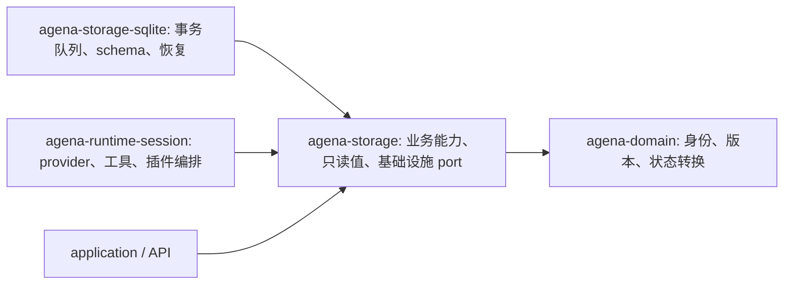
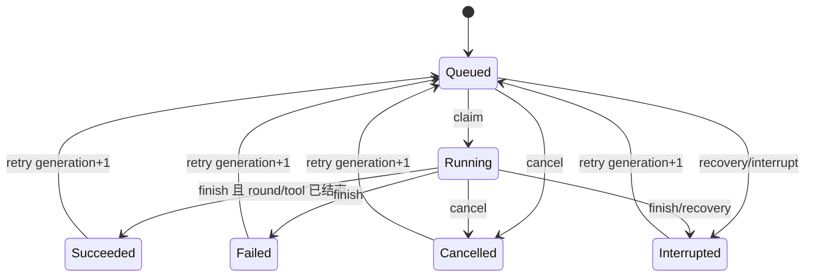

# 会话内核实现契约

本文件定义会话内核的当前 API、事务、缓存、资源与恢复语义。类型位于 `agena-domain::session_kernel`，业务能力位于 `agena-storage::kernel`，基础设施适配器契约位于 `agena-storage::backend::kernel`，SQLite 实现位于 `agena-storage-sqlite::kernel`。持久事实通过同一个内核写入；业务调用方使用用途明确的能力和不可变读值，不持有原始连接、独立内存业务引擎或通用 Session/Part 写回入口。

**依赖与能力**



storage 不依赖 runtime。普通编排与服务接收用途明确的能力，基础设施装配函数单独分发这些能力。

| 能力 | 操作范围 | 不拥有的权力 |
| --- | --- | --- |
| `SessionCommands` | create/configure、字段 metadata/selection、send/blob、cancel/retry/continue、reply、fork/rewind/withdraw/delete | claim、完成工具、签发内容、原始连接 |
| `ExecutorCommands` | claim 并签发 `AttemptHandle`；可靠 deliver/consume_delivery/resume_delivery | 任意 JSON 更新 |
| `AttemptHandle` | begin round、notice、prepare_stop、finish | 构造或反序列化别的 attempt 身份 |
| `RoundHandle` | begin tool/text、finish round 与 opaque state | 选择别的 session/attempt/round 归属 |
| `ToolHandle` | request interaction、begin text/log/document/terminal/mixed、complete、begin_activity | 修改权威状态以外的 detached view |
| typed output | append/apply/snapshot/patch、finish/interrupt | 别的 owner/source、任意删除/GC |
| `KernelReader` | metadata、session/workspace summaries、control_snapshot、entry/history、active executions/pending interactions、tool/outputs/blobs、interaction、round、content ranges/event pages/snapshots、entry_blobs/open_blob、watch | 保存读值、删除/维护内容 |
| `KernelPorts::shutdown` | 基础设施停止接收、排空已接收命令、关闭连接 | 普通用户流手工 flush |

`backend::kernel` 是适配器与装配契约，和既有 backend module 一样只供基础设施使用。runtime、application 与 API 的业务流程不导入 `Command`/`Scope`，也不接收数据库连接；基础设施装配持有的连接不作为业务能力传出。公开产品服务只持有上表相应能力；Rust 中可修改的 owned read value 没有通用写回路径。

业务调用方接收 `SessionCommands` 与 `KernelReader`，例如向已有会话提交消息并读取最近一页：

```rust
use agena_domain::{ComposerDocument, SessionId};
use agena_storage::kernel::{KernelReader, RequestId, SessionCommands};

// commands: &SessionCommands, reader: &KernelReader
// session_id: SessionId, document: ComposerDocument
let request_id = RequestId::new();
let committed = commands.send(request_id, session_id, document).await?;
let recent = reader.history(session_id, None, 100).await?;
```

`committed` 已含持久 execution 身份和本次提交位置；不需要再保存 Session 或 flush。响应丢失后，用同一个 `request_id` 与相同文档重试。`recent` 是受预算管理的不可变读取结果，没有通用写回入口。模型与工具编排另接收 executor/attempt 能力，不由普通业务服务完成工具或维护资源。

**身份、版本与终态**

正整数身份 `SessionId / EntryId / SegmentId / RoundId / ToolId / InteractionId` 与版本 `AttemptGeneration / EntryRevision / MetadataVersion / MembershipGeneration / CommitSequence` 相互独立。构造与 serde 都拒绝零/负值，增长必须符合 SQLite i64 范围。`CommandId`、`KernelEpoch`、`ContentEpoch` 与 `BlobId` 是独立 UUID 类型，不复用 `ContentId`。

`CommitPosition { sequence, ordinal }` 中的 sequence 对应命令实际提交的事务，ordinal 表示该批内的命令顺序。request digest、身份、确切结果与 receipt 在同一事务保存；幂等重放返回原 receipt，不能从之后读取的 metadata 重建它。新进程 epoch 不改变已存 receipt。

`SessionControlSnapshot` 是独立的只读观测，可以包含该命令之后已经提交的其他变更。它的 `control_version`、`SessionResource.version` 使用的 metadata version、命令 `CommitPosition`、membership generation 与正文 byte/event cursor 各有含义，不能互换。Application 的命令响应保留已确认的 execution/turn/reply 身份，再附上随后读取的状态；这个状态不重定义原命令的提交位置或精确结果。

每个 execution 指向一个 current generation。phase 的唯一事实是该 generation 的 attempt row；execution 不再另存一份 phase，历史 attempt 不覆盖。当前状态机如下：



同代相同终态决定幂等；不同终态冲突。cancel 已确认后迟到 success 无法覆盖。retry 原子增加 generation 并建立 queued attempt，旧 handle 的命令在访问新 attempt 前被拒绝。claim 为 running attempt 保存服务 epoch；后续 executor 命令同时验证 session、execution、generation、epoch 和阶段。

工具只有 `agena_tool_calls.phase` 一个事实；历史 entry 只引用 tool，`ToolView` 从此处投影。业务 JSON input/result 不拥有控制状态。交互以一条决定记录为事实；相同决定和 remember 参数可重放，冲突决定或改变 remember 语义会拒绝。规则与决定在一个 savepoint/事务内写入，规则中途成功、决定失败不会留下半成功。

**事务、队列与错误**

队列上限为 1,024 work items；content 最多占用其中 768 个，留出控制 admission。commands 按序列化 payload 加每请求固定开销记账 2 MiB，单命令约 1 MiB；ordinary content 使用独立 14 MiB budget，terminal frame 使用独立约 128 MiB reservation，避免大帧挤占普通流或控制容量。JSON tree、decoded views、projection、pin 与 subscriber 使用各自 modeled admission/保留记账；这些估算不包含全部 allocator、SQLite 与 OS 开销，不能把参数相加后宣称为进程 RSS 硬上限。

writer 收到命令后最多等待约 1 ms 收集一个 batch，最多 64 条，常规累计记账约 512 KiB。最后一条大命令可能使 batch 超过该目标，仍受单命令和全局队列限制。一个 batch 只有一次 `BEGIN IMMEDIATE` 与一次 COMMIT；每条命令使用 savepoint。同批后序命令看到前序有效结果；单条校验失败会回滚自己的变化，其余有效命令可提交。

KernelChange 保存 workspace 与列表可见性，并带最多128个 affected_entries；membership移除或超预算时 requires_snapshot=true。共享family结构变化会显式reset有界feed，而不是让子分支漏掉共享entry更新。

同一 FIFO 中的 append 是 batch 边界，不跨越 append 收集后序语义命令。普通 append 先安装 accepted head，无 SQL/持久 command envelope。共享的 64 KiB/约 500 ms checkpoint 提交 immutable blocks 和 committed head；byte trigger 只提交完整块，source 自己到期或结束时才封存尾部；完成/取消命令在自己的 savepoint 内包含所依赖尾部。失败不丢掉 pending blocks；不确定 COMMIT 关闭 writer、使 live view 失效，重开后核对持久事实。

request digest 与确切 receipt 和事实同事务写入。同 ID/同输入返回原结果；同 ID/不同输入拒绝。命令调用 future 被丢弃后，已进队列的请求继续完成，重试可查回身份；外部工具执行不属于存储重试的一部分。

| 结果 | 当前含义 |
| --- | --- |
| `Invalid / NotFound / Ownership / StaleAttempt / Conflict` | 该命令没有提交其变更；同批其他命令可成功 |
| `Busy` | 队列或字节 admission 未接收此命令 |
| `Storage` | 未执行 COMMIT，或 COMMIT 明确被 constraint/busy 拒绝，没有成功 receipt |
| `CommitUnknown { request_id }` | I/O/传输或 writer 响应丢失导致结果不确定；使用同 request ID 重试 |
| `CommitReceipt` | 事实与命令结果已经提交，随后通知不能变成普通未提交错误 |

SQLite transaction drop 负责在取消/错误时排队回滚，不能把 Drop 时刻当成数据库已完成回滚。archive、pinned history page、blob range 和原生 control snapshot 的成功路径显式等待 ROLLBACK 确认后返回，工具/网络与 sink 等待不持有这些事务。

`reader.control_snapshot(session, limit)` 在同一 SQLite 短读事务先固定 control version，再读取 metadata、summary、configuration、最多 128 项 pending/active 页与从索引控制事实派生的执行阶段。选择正在 running 的 execution 不受第一个按 ID 排序的 active 页限制；UUIDv4 身份顺序不是调度顺序。返回的 immutable `ReadView` 只保留读取预算，不保留事务或 control admission；warm hit 与 clone 共享同一 allocation lease。Application 在这份控制观测上同步叠加当前 runtime defaults，不重读其中已经固定的 persisted session facts。

根会话的状态、配置、执行阶段和根 pending 来自同一控制观测，`SessionExecutionResource.latest_event_seq` 标识该 `control_version`。每个 descendant task 有独立 control snapshot；history/parts/content、scheduler 的独立数据库、provider retry、usage 与 background observations 各有读取边界。整个 execution response、task tree 和原命令 receipt 不构成一个全局原子快照。命令已经确认后，Application 的后续 projection 失败返回 `session.command_committed_projection_unavailable`，impact 为 `PartialSuccess`、retry 为 `Never`、recovery 为 `Refresh`，明确要求刷新而不是再次提交；不能把它转换成普通的“命令未提交”错误，也不能要求数据库全局静止才承认已提交结果。

诊断从已确认 BEGIN 计到已确认 ROLLBACK，记录完成数、总/最大寿命、对数微秒分布和峰值 measurement scopes；未观测到回滚确认的提前错误/取消单独记为 abandoned，不进入完成寿命分布。计时不含连接池/BEGIN 等待或单语句隐式事务。post-commit feed 不执行任意 observer callback，也不等待消费者。缓存安装遵守同样边界，故障只使缓存失效或客户端 reset。

**持久化、所有权与恢复**

`KernelDatabase` 为文件库创建专用 1 writer + 最多 4 readers；reader 是 query-only。内存库保持一个 private connection，writer/reader 共享同一个 pool，避免空闲释放或另开匿名库。该 singleton pool 关闭 checkout ping、idle timeout 和 max lifetime，且没有 acquire/connect hook，防止取消 SQLx acquire 时丢弃唯一连接并销毁整库。文件库仍通过 retained callback 持有 owner 锁。named memory URI 也不让两个独立工厂共享同一实例。

每连接设置 FK、FULL、`cache_size=-8192`、`mmap_size=0`、busy timeout=1 s 和 WAL autocheckpoint=1,000 pages；文件模式使用 WAL。页缓存是 SQLite 软目标。Runtime 组合与 reload 复用同一个 `Arc<SqliteKernel>`，基础设施 workspace/permission/model-catalog repositories 共享其数据库生命周期。

持久库先解析 SQLite URL 并规范化文件与父目录符号链接，再持有 `<canonical-db>.owner-lock` 的 OS 锁。已有硬链接文件拒绝使用，因为 SQLite WAL 自身也不能安全地以多个硬链接名称访问。锁附着在 pool retained callback，pool clone/后台任务保留所有权；不删除锁文件，不通过 PID/文件是否存在判断占用。进程 kill 后 OS 释放锁。

当前 kernel schema 与旧 Part schema 是互斥的数据库格式。初始化只允许空库或精确匹配的声明；不往旧库加一套 chat tables，不在生产双写。workspace/permission/model-catalog 是同一数据库内的基础设施表，不提供旧 session adapter。没有旧数据转换工具或迁移链；不匹配库保持原样，调用方改用新的数据库路径。

startup 在索引覆盖的 active 工作集上把 running attempts/rounds/tools 与未决定交互收敛为 interrupted/cancel，并中断 open capture；不会执行 provider/工具。queued 用户请求保持 queued。blob pin 行在新 epoch 清理；准备可通过原 request ID 和同一输入流重放，新的 pin 不改变 chunk/finish 的幂等身份。managed blob 的基础协议与限制见下节；Runtime 已调度有界维护，分支删除保留其他分支和 snapshot 所需的引用。

**Managed blob 协议与边界**

`SessionCommands::prepare_blob(request, session, expected_bytes, reader)` 只读取调用者显式交付的 stream。128 KiB chunk 与各自 SHA-256 存入同一 SQLite 引擎，file/memory 走相同逻辑；整流 SHA-256 与实际长度在 ready 边界固定。默认没有新增 sidecar 文件格式。`LocalPath` 附件仍是本地引用，不隐式复制、读取或上传。

`PreparedBlob` 的私有 pin 随 Clone 共享；重放准备可以建立另一个 pin。`send_with_blobs` 与 `complete_with_blobs` 在业务 savepoint 内验证 ready、session、pin 和引用上限，并同消息/执行或工具终态提交引用。失败不留下成功消息或终态。每 entry 最多 16 个 blob refs；普通 JSON 不拥有引用/回收权。

`KernelReader::open_blob` 通过历史 membership 授权并签发只读 pin，`range` 最多 128 KiB、最多两个物理 chunk，并验证 chunk digest。`copy_to` 额外检查完整 SHA-256。读取 pin 在引用被内部维护移除后仍保护正在读取的数据；普通 reader 没有删除能力。准备并发上限 2、全局持久 pin 上限 128；这些是 admission 参数，不是 RSS 声明。

`SqliteKernel::maintenance` 是基础设施单独持有的能力，`collect_blobs` 与其他命令排在同一 FIFO。Drop 仅标记失去 family，不承担异步成功。GC 在 retain 使用的同一锁中撤销可回收 pin，再在一个事务中清理 pin、检查 refs、标记 retired；新 publication 不接受 retired。每次检查 16 个 blob identities、最多删除 8 chunks（1 MiB），使用持久 scan cursor，避免所有旧 blob 均被引用时全表扫描。出生未取回的 preparation/pin 保留 30 s grace。准备请求在 GC 后可以明确失效，不承诺无限期保留未发布资源。

当前没有自动内容/用户历史删除；周期 GC 只回收无引用、无活跃 pin 的 managed blobs。branch 的公共删除通过 kernel 命令完成，保留仍被其他分支或 snapshot 引用的事实。进程在 prepare、publication、checkpoint 或 GC 边界退出后，重开只恢复已经持久提交的事实；缓存安装、通知和 receipt 发送不替代持久提交。外部系统没有幂等配合时不承诺 exactly-once。

发生 `SQLITE_FULL` 并由 SQLite 自动 rollback 后，SQLx 0.8 可能保留 transaction depth。内核在从未尝试 COMMIT 的失败路径建立一个可 rollback 的空事务以清理 driver depth；清理失败关闭 writer。COMMIT 不确定仍要求重开，不应用这个修复掩盖不确定性。

**读取、segments 与 watch**

普通历史页限制 1–200 entries 和约 1 MiB decoded body 记账。先用 `(session_id, sequence)` 取有界段引用，再按 `(segment_id, ordinal)` 取范围并连接 entry，禁止先装完整会话再截取。用户文档目前上限 256 KiB，大工具数据通过小 entry ref 留在工具详情。内容和历史正文读取使用八操作 admission；状态与控制查询使用独立的八操作 admission，二者仍共享同一个只读 SQLite pool（文件库最多四连接，内存库一连接）。entry detail、owned active execution pages、pending interaction byte windows、增量 summary、frozen-input PromptView、pinned history roots 和 JSONL 流式导出均提供专用有界查询；自动 prompt/checkpoint 选择由 `begin_current_round` 与 manager 的压缩编排完成。

control lane 包括 metadata、configuration、summary/listing、control version、active execution、pending interaction、execution/tool/interaction/round 详情、latest round、prompt-window status、task lookup 和活动状态查询。Text/event page、event snapshot、history、PromptView、owned-tool 正文、snapshot page、round/delivery 批量页和 capture-loss 页保留原 content lane。两类许可只覆盖单次读取的排队、SQL、校验/解码及 view 构建，函数返回或取消时释放；返回的 ReadView 只保留下面的 allocation lease。SSE ContentWatch 长期保留每订阅 4 KiB 的订阅 lease，在等待下一次变更或传输页面时不保留 SQL 事务或上述读取许可。八个内容观察者同时读页不能占用状态/取消/权限查询的 admission；control lane 自身过载仍明确返回 Busy，不建立无界队列。此分流不新增写权限、不改变 membership 授权或读取视图的全局/source 字节预算。

一个不可变段最多 128 memberships；append 仅复制未满尾段，其他段保持共享。发布段不能插入、更新或删除 memberships；切换引用后没有任何 session 引用的旧尾段在同事务回收。fork/rewind/withdraw/delete 已通过 `SessionCommands` 暴露，并由同一 writer 更新 membership、统计和失效通知。

`HistoryCursor` 绑定 session、membership generation、段序与 ordinal；membership 已变则要求重新分页。EntryRevision 用于共享事实变化；metadata 字段变更只推进 MetadataVersion，不伪装成 membership。正文 `TextCursor` 使用 byte offset，事件 `EventCursor` 使用 sequence，均绑定 content ID/ContentEpoch，不以 session version 代替。重启恢复只暴露 committed head，open source 更换 ContentEpoch 并标记 interrupted，旧 accepted cursor 显式 reset。

SDK 的 `part_text` 是有上限的预览投影；完整复制/导出使用 `write_part_text(session, part, AsyncWrite)`，按引用顺序写出 native Text 后追加 inline `content.text`。每 source 的首次响应固定 epoch 与 head，64 KiB 分页，只写到该初始 UTF-8 字节 head，没有 8 MiB 总量截断，也不无限追随活跃新增。`write_content_text` 复用相同 native reader，并对 Log 使用 `/text` 的 `(after record cursor, UTF-8 byte offset)` 继续大记录；初始 record head 内最后一条记录完整写出，之后的新记录排除。gap、epoch reset、错误 continuation、提前结束或不前进均显式报错，sink 已写前缀归调用方，调用方负责 flush、close 或丢弃部分文件。clipboard 的完整 Vec 收集是显式 consumer allocation；文件导出直接流式写出。

Structured、Document 和 Terminal 的最终文档/屏幕需要 typed projection；`/text` 对这些状态变更可能只有 position 推进、没有 slices，因此 SDK 文本 writer 对这些类型明确拒绝。客户端必须用 typed event/checkpoint 在固定初始 head 收敛最终状态后渲染，不能以空文本页作为完整导出成功，也不退回旧协议或预览截断。

低频变更 feed 使用当前 `KernelEpoch` 与 `CommitPosition`，一个 256 条共享 ring，broadcast 不反压 writer。subscribe、head 和已有 replay 在同一锁内取得，调用方先 watch 再 snapshot。旧 epoch、越过 replay floor、未来位置或不同 session cursor 要求新 snapshot；慢消费者收到明确 Reset。持久幂等重放不发布重复变更。共享分支变化通过 kernel feed 提供受影响 entry 与 snapshot 要求；HTTP wire 投影及 Web/TUI reducer 已接入 remove、epoch/reset 与有界快照恢复。

**ReadView、预算与缓存（当前契约）**

metadata、execution、history、tool、interaction、round、text/event ranges、event snapshot、blob ranges/refs 和 ContentWatch head 都返回 `ReadView<T>`。它只暴露 immutable Deref 与共享 Clone，没有可拆走的 raw Arc 或 mutable dereference；HistoryPage 内部使用 owned entry values，EventSnapshot 的 document/terminal 是 Box，因此不能克隆内部裸 Arc 绕开 lease。调用方主动对 T 做 deep copy 属于 consumer allocation。

每个新 kernel 实例使用共享 ReadBudget：全局 256 MiB modeled retained bytes、每 session 192 MiB；普通每 source 32 MiB / 256 allocations。合法大 atomic event view 单独保留一个 large allocation，并仍受全局/session 上限；普通 view/heads 与大型 view 分开计算，订阅存在不会阻止合法大帧。

全局 allocation 上限 8,192、每 session 2,048；订阅上限全局 1,024、每 session 512、每 content 64。receiver/replay handles 按每订阅 4 KiB 计账。`ReadBudgetSnapshot` 暴露 current/peak bytes、allocations、source/session 数、subscribers、拒绝次数。普通 byte Vec 直接按 capacity 计账；typed views 通过不分配 JSON/tree 的 Serializer traversal，以 sizeof(T)、每 value node 128 bytes、字符串 2×长度和 256-byte shared header 建模。这不是 allocator RSS 或 SQLite page-cache 的硬上限；query decoding/projection、SQLite、provider buffers 和 consumer deep copies 属于独立的瞬态或消费方分配。

Cache 只保存共享 immutable views，最多 16 MiB / 2,048 keys，LRU eviction 不会取消 consumer 仍持有的 allocation lease。已知有效 warm metadata/history/execution/control snapshot/tool/interaction/round 命中无需 SQL，也不占读取操作许可；没有按会话总数保存完整历史。miss 按查询用途使用上述 control 或 content 的八操作 semaphore。query 返回的 allocation 若无法 admission，先驱逐 cache 再重试 reservation；调用方保持所有旧 views 时会明确 Busy，释放后可恢复。

纯容量回收 `evict()` 清除缓存条目、物理块索引及缓存自身的当前记账，但保留 authority generation。因此顺序读取不会因自己的回收动作被误判为授权失效，调用方仍持有的 allocation lease 继续生效。`clear()`、`close()` 与 COMMIT/显式失效仍推进或围栏 generation，禁止过期 fill 回装；容量回收不能代替这些权限失效操作。

普通事件页复用受同一 COMMIT fence 保护的 membership/identity context，以及按 `(session, content, epoch, block start)` 缓存的已校验物理块。一个有序索引只包含当前 LRU 中的块，节点计入 cache entry 的固定开销；驱逐、失效和关闭同步移除索引，不枚举或保留整个 source 的块目录。不同分页起点可以定位同一个块，再用块内 offsets 直接找到所需 sequence。context 和所需块均有效时，热页不执行 SQL，也不占 content operation 许可；大帧仍受独立 frame admission 约束。

事件页不缓存会变旧的 accepted/committed head。open source 每次在同一个 live 锁内捕获 head 和本页可能用到的 tail；已提交记录已填满页时不复制 tail，未封块只复制与请求相交的最多 256 条记录。实时捕获前后的 cache generation 必须一致且不处于 COMMIT fence，否则返回 Busy 重试，不能拼接撤权前的 membership 与提交后的内容。sealed head 随 session/family invalidation 更新；retention、withdraw、delete 和 fork membership 仍决定可读范围。缓存不足时，短读事务重新授权、读取当前 identity 并按块定位，显式等待 ROLLBACK 后才返回。frozen-input `_at` 页继续在自己的 SQL snapshot 验证当前 epoch/floor，并严格停在给定 committed boundary。

Writer 在 COMMIT 前安装 cache fence，暂时禁止 warm hits/fills；成功后按受影响 session 安装 invalidation，再恢复 cache、发布 feed 和签发 receipt。开始于旧 snapshot 或 COMMIT 中的 fill 不能重新安装 stale data。definite COMMIT rejection 保留原 cache，uncertain COMMIT 关闭 cache 与 writer。普通 content checkpoint 不改变 entry view；abandonment/shutdown seal 推进 revision 时另外 fence 并失效 cache。基础设施 `maintenance.invalidate_read_cache` 可显式撤销已知 cache validity，普通业务没有此权力。

低频 feed ring 和 recv 也使用 ReadView，不能由消费者长期持有裸 Arc 而退出计账。post-commit publication 遇到预算耗尽时推进 head/floor、发 Reset；不会把确定成功的业务 receipt 变成普通失败。ContentWatch 仍是 coalesced 通知，head/changed 的返回快照受预算保护；Busy 后释放旧视图并重新读取 head，不应只等下一次通知。

History 先读身份/ordinal 和 generated STORED body_bytes，用 `(id, body_bytes)` 索引选出 1 MiB/200-entry 窗口，再取限定 entry IDs 的正文。EXPLAIN 与 VM 验证 preflight 不从 entries table 读取 cold JSON；计数是实际 SQL result rows/body bytes，不是 engine page I/O。循环外键还具有 message、attempt、round、content、round-input、delivery、checkpoint 等反向索引；实际 VM fixture 验证插入/删除的适用 child checks 不从 growing tables Rewind。生产 runtime 使用有界 metadata/history/prompt 读取。

**Retained prefix 与物理回收**

`ContentStreamView.retained_start` 声明逻辑保留起点。基础设施单独持有 `maintenance.prune_content`，open capture 拒绝 pruning；普通 writer/reader 没有删正文的入口。text/log 的 floor 是原 byte/event position，document/terminal 则回退到目标之前的有效 checkpoint（floor=该 checkpoint sequence−1），并检查 block checksum、index、payload kind 与完整 checkpoint。

读位置小于 floor 返回 `ContentGap { content, requested, retained_start }`，不偷偷改成后缀；保留后缀的 epoch/positions 不变。`event_snapshot` 从保留 checkpoint 继续恢复相同 document/screen。floor、prefix gap、entry revision 与一批物理回收在同一 savepoint；每次最多 8 blocks、普通目标 512 KiB，一个大型 atomic terminal block 可单独超过目标。`pending_reclamation` 使维护调度分批继续，不把长日志删除放进一个无界事务。重放同 request 返回原 receipt，后续批次用新 request。

内容 retention 只提供显式 sealed prefix pruning，不在运行 source 上自动删除历史。任意 prefix 外删除不属于该能力；捕获丢失另用不可变 capture-loss windows 表示。当前格式 archive 保留 retained floor、gaps 和 loss 描述；没有旧格式转换。客户端必须根据显式 gap/reset 恢复，不把不可用前缀当成完整正文。

**查询契约**

单 session summary 从 session/statistics 两行读取，不读取 selection JSON、history 或按 attempt 聚合。entry_count 统计 membership，user_message_count 统计用户边界，queued/running 只统计当前 owned attempt。create/send/claim/retry/finish/append/recovery 在同一事务维护，重复终态不会二次扣减。last_message_at_ms 在 send 和首次终态/中断时单调推进，metadata/selection 只推进 updated_at_ms。

workspace summaries 依 (updated_at_ms,id) 降序 keyset 分页，最多 200 rows 加一条 lookahead。cursor 绑定 workspace；分页是 live listing，期间更新可把 session 移到已读页之前。workspace 分配有真实 ReadOwner、16 MiB/512 allocations 上限，并共享全局 256 MiB/8,192 allocations；不归到任意 session。writer 在 COMMIT 前捕获当前事务中 affected session 的 workspace，成功后同时撤销这些 workspace 的 list cache。旧结果是 immutable 历史值，已知有效 warm lookup 为零 SQL；其他 workspace pages 不被此变更撤销。

entry detail 按 membership 授权；active executions 的 cursor 绑定 session，≤200+1 rows，重试只列 current generation。pending interactions 先用 stored request_bytes 覆盖索引选择约 1 MiB/200 项，再取限定 JSON；reply/cancel/recovery 后不再出现在 pending 索引。

`owned_tool_entries` 为文件变更等 origin-owned 工具投影提供专用页。`(origin_session_id,id,body_bytes,tool_id) WHERE kind='tool'` 的 partial covering index 只枚举工具身份；membership reverse index 验证这些身份仍属当前会话。工具 input/result 的 generated size 由独立 covering index 读取，普通文本与 opaque round state 不进入 SQL 载荷。预选限制 128+1 candidates，以每项固定开销和 body/input/result 字节数限定 1 MiB，再获取选中 EntryView。cursor 绑定 session、membership、EntryId 和首次读取的工具 ID 上界；control version 仅作为观察信息，不因标题、round、文本等无关更新拒绝文件历史。追加工具由下一次资源同步读取，不能无限延长当前分页；真实 membership 移除导致锚点丢失时才重启分页。每个工具详情来自后端的有界权威读取，HTTP 响应保留读取开始前的资源版本，读取期间发生的编辑不能把旧快照标记为最新。超大单条不能静默截断。

**Pinned roots and streaming JSONL archives（当前契约）**

`reader.history_snapshot(session)` captures metadata, entry count and one
membership-generation root pin. `snapshot.page(after, limit)` walks forward,
at most 200 entries / about 1 MiB entry bodies, using stored byte lengths before
fetching bodies. Root pins are limited to eight globally and two per session;
they copy no complete membership manifest. Current and retired edges jointly
describe the pinned generation. Append archives only the replaced tail needed
by a root. Fork/rewind create branch references without rewriting the source
membership. Withdraw retires the applicable pinned edges before replacing or
removing them, in the same writer savepoint. Delete records a tombstone and
settles origin-owned execution while retaining shared membership and pinned
roots. These current commands preserve existing readers without copying a
complete membership manifest into memory. A root or returned page holds no SQL
connection/transaction. Last Drop marks a release; bounded writer maintenance
reclaims roots/retired references. Failed collection is retried. Old process
roots are cleared during startup recovery.

`reader.export_jsonl(session, sink)` creates a root and writes the whole pinned
transcript. `snapshot.export_jsonl(sink)` uses an existing root. Both write to
`AsyncWrite`; neither accumulates a complete archive or awaits the sink inside
a read transaction. Separate admission allows eight exports globally and two
per session, including callers using clones of the same root. Source facts and
serialized output buffers retain their read-budget leases across sink waits.
Each encoded record is counted before allocation and admitted by byte length.

Version 1 is newline-delimited UTF-8 JSON, each line `{ "kind": ..., "data": ... }`.
It begins with `header`, with format `agena.session-kernel`, version `1`, the
captured `snapshot`, and scope
`fixed_membership_per_record_controls_committed_sources`. This is a transcript
archive with declared observation scopes, not a globally atomic SQLite backup:

- Metadata and entry membership/order are fixed at root creation. Each entry's
  revision, attempt/execution observation, tool/interaction facts, source IDs
  and ordered blob references are captured together in a short transaction.
- For each user entry, attempt enumeration stops at its observed current
  generation; round enumeration stops at the observed greatest round ID.
  Rounds are emitted once per user execution, including rounds with no output.
  Inputs/replays use 200-row pages; frozen source descriptors are read one at
  a time. The exporter never repeats a whole input array for every output.
- Each source captures its own committed head, epoch, retained floor, state
  and diagnostic when visited. Accepted-only tails and later committed blocks
  are excluded. Control/source observations made later can refer to identities
  outside the fixed membership; those references do not add transcript entries.
  Historical per-entry observations need not equal a later observation of the
  same execution. An importer must keep their declared scope.

The record mapping is:

| Kind | Data and interpretation |
| --- | --- |
| `entry` | Snapshot position, typed entry, timestamp, round reference, captured execution/attempt observations, raw tool/interaction columns, source IDs, ordered blob descriptors and round enumeration bound |
| `attempt` | One attempt record belonging to that user execution |
| `round` | Round identity/owner/ordinal/timestamps/phase; exact stored `provider_state_json` and `input_metadata_json` strings |
| `round_input` | One ordinal, entry identity/revision and frozen tool/interaction availability |
| `round_input_source` | Captured input source identity and exact stored head JSON |
| `round_input_replay` | Captured source-round identity/phase/opaque availability |
| `content` | Captured stream descriptor plus `physical_start` of its first exported block |
| `content_gap` | Original logical range and reason; gaps/floor govern what is available |
| `content_block` | Identity, logical range, codec, original SHA-256 and physical byte length |
| `content_piece` | Content/block identity, byte offset and exact block bytes as lowercase hex; at most 64 KiB decoded bytes |
| `content_checkpoint` | Logical checkpoint sequence and containing block start |
| `blob` | Referencing snapshot position and immutable blob descriptor |
| `blob_piece` | Blob identity, byte offset and at most 64 KiB bytes as lowercase hex |
| `footer` | `ExportReport`: entry/preceding-record counts, preceding-byte count, SHA-256 of every byte before the footer, including newlines |

Raw JSON columns are strings in the archive so unknown fields and their exact
stored representation are not projected away. Content blocks preserve their
codecs, so log channel/time/ANSI/CR/Unicode/whitespace and document/PTY checkpoint
chains survive. A logical retention floor can lie inside an immutable block.
The complete boundary block is preserved, including its checksum, and
`physical_start` can therefore precede `retained_start`; earlier bytes/events
in that block remain logically unavailable. Restore/replay must honor the
floor/gaps and start at the retained checkpoint. Fully preceding blocks are
not exported, even if their physical reclamation is pending.

Blob references use array order as their field ordinal. A shared blob may be
emitted again at another reference; its identity/length/digest remain the same.
No unbounded in-memory identity set is kept. Active blob reads use separate
pins, authorized through the snapshot's current or retired membership. Every
physical chunk and whole blob is checked; every content block is checked as
its pieces stream. Cancellation releases the pin and output allocation leases.

Records are capped at 32 MiB encoded (plus newline), accommodating escaped
captured metadata; ordinary pieces are about 128 KiB hex. SQL row/codec buffers,
SQLite page caches and sink-owned copies are additional transient/consumer
memory, not a process RSS promise. SQLite can materialize a bounded atomic
block internally when slicing its BLOB. No entire media/blob is loaded.

Retention advancing past a captured floor, epoch reset, corruption, shutdown,
admission rejection or sink failure returns an error and does not write a
success footer. A consumer must reject a missing/incomplete footer or mismatched
count/digest. The sink owns partial output and publication/rename policy.
Current-format archive export/import is integrated through the kernel, runtime,
Application and streaming HTTP/SDK/CLI paths. Import validates private staging
before atomic publication, retaining a stable request identity for replay.
Web/TUI transcript exports remain Markdown presentation features. No old-database
or old-archive conversion is provided.

**Runtime runner 与 provider 输入契约**

`ToolDraftHandle` 只暴露稳定 ID 与 finalize；Preparing 不能请求交互、输出或完成。
finalize 校验 owner/generation/round，原子安装参数并签发 ToolHandle。同 request
重放返回原结果；已冻结输入仍保留 Preparing/null。`ToolExecutionKind` 区分 Runtime
与 ProviderHosted；后者不能请求本地权限。失败轮次、取消与恢复会中断未完成 draft。

`KernelPromptHydrator` 将单个冻结 PromptView 转为 provider 输入，正文只读 captured
committed heads。成功 round replay 绑定 provider/adapter/model，未知字段仍保留在
原始 JSON 中；签名/加密值与 reasoning reference 恢复保持准确。工具预览有显式
边界，PTY 使用 plain screen text 并保留原 source；必要 reasoning 不静默截断。

`SessionProcessor::kernel_round` 是生产 processor 的执行路径，使用实际 registry 与
chat.params hook。`KernelRoundRun::drive` 保留有序 pending command、固定 request ID
及 in-flight future；等待 future 被丢弃后不会重新 append 已接收字节。终态提交失败
保留 exact completion，不重发 provider 或提前返回可执行工具。runner 整体 Drop
意味着中断，不会自动重复外部效果；manager 持有有界执行与准备监督器，持久化重试保留原 runner。
registry 的 draft stream mode 允许实时 Preparing 展示；非法调用失败，不在已发布
身份后内部重发 protocol repair。生产 manager 通过此路径执行 provider round。

当前 prompt 与 runner 分别用独立 process-wide ReadBudget 保留 32 MiB modeled
reservation；storage read views 另外计账。它们不是总 RSS 上限，SQL/codec/adapter
瞬态、业务结果复制与其他组件的并发分配不在同一记账边界。

**Independent activity and native output admission（当前契约）**

`ToolHandle::begin_activity` validates a running local tool and its resolved
authorization, commits a launch intent and returns an ActivityHandle. Launch
the external effect only after this receipt. Output authority is explicitly
`OutputScope::Attempt` or `OutputScope::Activity`; an activity scope grants no
attempt control. Activity streams stay bound to their launch tool entry while
their lifetime survives parent completion, cancel and retry. Activity::end
commits an observed terminal outcome and accepted output tail atomically.
The same observed outcome is idempotent and a contradictory outcome conflicts.
An external failure may still have complete capture. Recovery interrupts
activity intents, resets open capture epochs and never repeats external effects.
An intent without an outcome does not prove that an external launch happened.

Activity detail reads use transcript membership. Active pages contain only
origin-owned activities and use an indexed, bounded keyset query. Caps are 128
active activities globally and 16 total per tool. Tool views/source descriptors
declare the association; archive entry observations include raw activity facts.
Shared-branch changes invalidate their views without granting origin execution rights.

Native synchronous output admission returns a real accepted byte/event cursor.
It takes no disk/queue/observer wait and rejects memory-lock/budget contention
with Busy, accepting nothing. Async producers retain their queued FIFO path.
Concurrent mixed calls linearize at actual admission. Producers draining pipes
must report discarded input; native production tools use typed kernel output
capabilities and persist capture-loss windows. No pending pump cursor is
presented as a canonical PTY patch base.

Terminal commands provisionally fence memory admission until transaction
resolution. A failed command releases only its own gate; a transaction rollback
releases all of that writer batch's provisional gates. Ordinary checkpoint
acknowledgment preserves newer accepted suffixes and reservations. Commands
also seal matching durable sources that were opened earlier in the same batch
and are not live yet. Installation uses final transaction source state; receipts
retain their per-command observations. Open/finish/cancel in one transaction
therefore cannot install an active writer after its owner has ended.

The production tools/manager, loss reporting, typed mixed-source projection,
background supervision/delivery and branching/clients now use these capabilities.

**分支、可靠交付与捕获损失**

fork 的切点解析到所选消息当前可见的最后一条事实，段引用在同一事务冻结，不在内存复制完整历史。rewind 要求已完成的 user entry 并恢复其输入；withdraw 只允许最后一个已完成 origin user input，保留其他分支与 pinned snapshot 所引用的成员。读取可通过 membership 访问 inherited execution/round/content；写权限始终校验 origin 与 attempt generation。

`fork_conversation` 在同一 Fork 事务内固定 Side/Btw 模式。Btw 从首次 INSERT 与变更通知起就不进入可见列表，不发布“普通 fork 后再设为临时”的中间状态。父 summary 只统计非临时子会话；模式可见性变化与父关联、删除一起维护计数，并使父 summary 缓存和资源时钟失效。

后台 ActivityHandle 在外部 effect 启动前提交，生命周期独立于 launch tool。Runtime 持有准备与执行监督器；等待 future 被丢弃不会撤销已接受任务，也不会为持久化重试重新执行工具。固定业务 key 的 delivery payload 不可更换；空闲 continuation 的 `resume_delivery` 在同一事务中创建 queued generation、追加 Notice 并消费 delivery，消除消费与 wake 之间的崩溃窗口。

捕获损失不占用 accepted position。capture-loss packet序列可包含零字节结构损失；有界pending窗口在相同位置合并，immutable durable窗口与source committed head一起提交。读路径校验membership、ContentId、epoch和已提交窗口边界；原始字节数与packet数分别累计，retention不重写这些损失事实。

当前 schema 必须逐对象精确匹配；没有旧格式转换、alias 或兼容分支。打开不匹配库时失败并要求新的路径，不自动改写或删除原库。新格式archive在owned临时staging校验后由writer单事务发布；support dependencies不成为导入session的可见membership。

**正常停止边界**

`AttemptHandle::prepare_stop` 与可靠 delivery 发布在同一 writer 中排序。pending delivery 或仍在可见 membership 中且未被成功 provider round 观察的业务 Notice 返回 `Continue`；失败或尚未冻结该 Notice 的 round 不完成观察。成功 compaction commit 同事务确认其冻结输入，避免 Notice 已转入 summary 后永久要求普通 round 再次直接读取。当前会话的其他 queued/running 输入、origin-owned 活跃 activity、仍可触发的 scheduler job 返回 `AwaitingBackground`：manager 完成并释放当前 attempt，跳过正常 `agent.stop`，等待真实 delivery 唤醒，不制造轮询模型调用。

`Ready` 原子设置当前 attempt 的 stop fence，再派发 stop hook。定向 guidance 在此边界之后拒绝；普通业务事件仍可持久化并在后续执行中唤醒。hook 追加 follow-up 后，新的真实 round 在同一事务中清除 fence；旧 generation 的句柄仍然无效。成功 finish 也检查 pending 定向消息，覆盖等待分支与 guidance 到达之间的竞态。

Scheduler facts 在独立数据库中先读为有界快照，再提交 kernel stop 命令；两库没有跨库原子事务。周期任务或未来一次性任务持续阻止正常停止。尚未收到 scheduler ack 的一次性 claim 只有在其精确 `scheduler:{job_id}:{delivery_key}` 已经由成功 round 观察后才能不再阻止停止，避免等待 execution 释放才能 ack 的互锁。stop 决定之后的新计划或业务到达按后续唤醒处理。`wake:false` 的普通 hook 诊断保留为 Notice，不强制额外模型轮次；定向 guidance 仍必须由其所属 execution 完整观察。

**测试状态**

2026-10-24 起，仓库的 Rust 测试已整体移除，等待重新规划统一的测试体系。本节原先列出的契约测试文件与断言不再存在；上文保留的是实现语义，不是当前测试覆盖证明。
